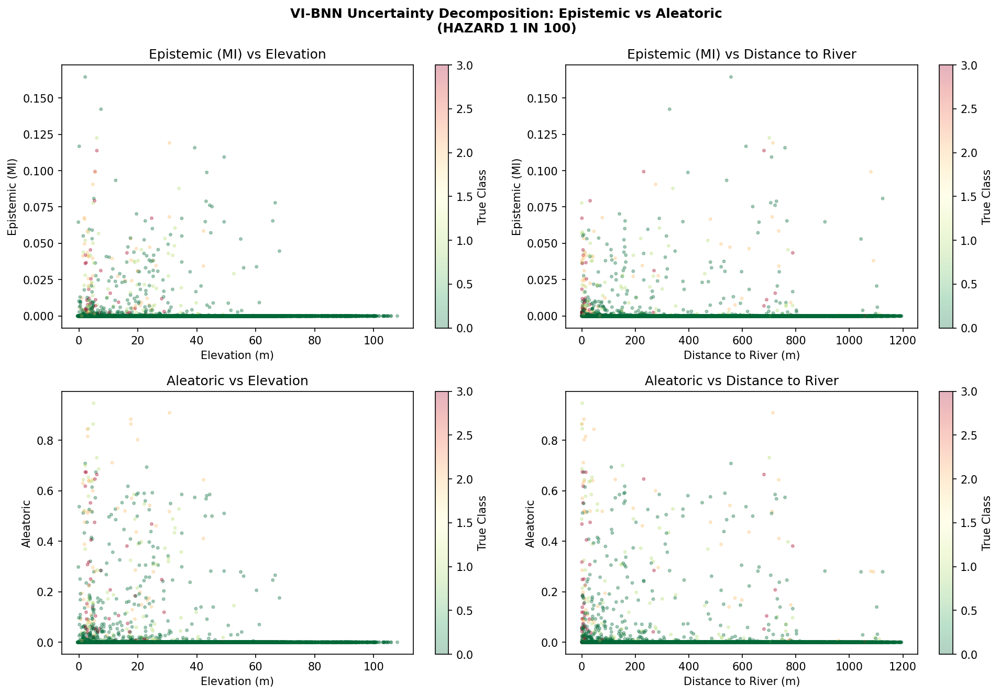

# Flood-hazard uncertainty with Bayesian neural networks: VI vs MCMC

This project compares variational inference (VI) with MCMC (Pyro NUTS) for the same Bayesian MLP. The task is to classify surface-water flood hazard for **65,528 grid cells** in Exeter, UK, at three return periods: 1-in-30, 1-in-100 and 1-in-1000 years. The comparison is judged on probabilistic fit, calibration and cost, not accuracy.

*Started as MSc coursework; refactored and extended.*

## Key results

The test set has 13,106 cells per hazard. Lower is better for NLL, ECE and Brier score. Higher is better for the uncertainty–error correlation, which is the correlation between predictive entropy and misclassification.

| Return period | Model | NLL | ECE | Brier | Unc–err corr. | Accuracy | Training time |
|---|---|---|---|---|---|---|---|
| 1-in-30 | VI | 0.0515 | 0.0061 | 0.0036 | 0.510 | 99.16% | 125 s |
| 1-in-30 | MCMC | **0.0262** | **0.0023** | **0.0030** | **0.592** | 99.18% | 4,775 s |
| 1-in-100 | VI | 0.0400 | 0.0050 | **0.0033** | 0.468 | 99.24% | 83 s |
| 1-in-100 | MCMC | **0.0306** | **0.0034** | 0.0034 | **0.694** | 98.94% | 4,783 s |
| 1-in-1000 | VI | **0.0645** | 0.0099 | **0.0074** | 0.645 | 97.97% | 58 s |
| 1-in-1000 | MCMC | 0.0665 | **0.0080** | 0.0090 | **0.657** | 97.31% | 6,628 s |

- **MCMC cut NLL by 49.1%** on the 1-in-30 hazard and by 23.6% on 1-in-100. On the rarest hazard (1-in-1000) the two methods are level.
- **MCMC was better calibrated on every hazard.** Its ECE was **2.63×** lower on 1-in-30, 1.47× lower on 1-in-100 and 1.25× lower on 1-in-1000. All six models have an ECE below 0.010.
- **MCMC's uncertainty flags errors better.** On 1-in-100 the entropy–error correlation is **0.694** for MCMC, against 0.468 for VI.
- **The cost is 38–115× the training time.** NUTS took 4,775–6,628 s (about **80–110 min**) per hazard on CPU. VI took 58–125 s.
- **Accuracy cannot separate the models.** It stays between 97.3% and 99.2% because class 0 (no hazard) makes up 99.3% of cells for 1-in-30, 98.2% for 1-in-100 and 93.2% for 1-in-1000. This is why the comparison leads with NLL and calibration.
- **VI predictive entropy rises closer to rivers.** It is negatively correlated with distance to river on all three hazards (Spearman ρ −0.22 to −0.32; see `results/entropy_feature_correlations.csv`).



*VI-BNN uncertainty for the 1-in-100 hazard, split into epistemic (mutual information) and aleatoric parts and plotted against elevation and distance to river.*

## How to run

```bash
python -m venv .venv
# Windows: .venv\Scripts\activate    Linux/macOS: source .venv/bin/activate
pip install -r requirements.txt notebook
jupyter notebook bnn_flood_uncertainty.ipynb
```

> **Runtime warning:** a full run takes **several hours on CPU**. NUTS takes about 80–110 minutes for each of the three hazards, and VI about 1–2 minutes per hazard. To test the pipeline end to end, set `SMOKE_TEST = True` in the configuration cell first. That run takes about 7 minutes on CPU, and its metrics are not meaningful.

- **What the notebook does, in order:**
  1. Load the data and drop incomplete rows.
  2. Merge hazard class 4 into class 3.
  3. Split 60/20/20, stratified by class.
  4. Apply SMOTE-Tomek to the training split only.
  5. Train and evaluate the VI-BNN, with KL annealing and 50 Monte Carlo passes.
  6. Run NUTS (200 warm-up steps, 150 samples, 5,000-cell pre-SMOTE subsample) and evaluate the MCMC-BNN.
  7. Retrain VI for an uncertainty analysis and save the figures.
- **Both models** use the same 64 → 32 → 4 MLP.
- **Outputs** are written to `outputs/` (git-ignored). The results of the reported run are in `results/`.
- **Reported environment:** CPU only, with Python 3.12, PyTorch 2.10, Pyro 1.9.1, scikit-learn 1.6.1 and imbalanced-learn 0.14.1. The seed is fixed (`SEED = 50`). Expect small differences with other library versions.

## Data

The dataset is the Exeter surface-water flood-hazard grid compiled by Li et al. (2021):

> Li, Z., Liu, H., Luo, C. and Fu, G. (2021). Assessing surface water flood risks in urban areas using machine learning. *Water*, 13(24), 3520. <https://doi.org/10.3390/w13243520>

- **Contents.** Each row is a grid cell with coordinates and terrain, land-cover and proximity features. These are elevation, slope, NDVI, imperviousness, land use, lithology, substrate, building type, and distance to the nearest river and road. Each cell also has an ordinal hazard class (0–4) for each of the three return periods.
- **Size.** The raw file has 67,330 rows, and 65,528 remain after dropping incomplete rows.
- **Getting the file.** This repository does not redistribute the data. Obtain it through the paper above and save it as:

```
data/Flood_Data.csv
```

Check the data's licence terms with the source before reusing it.

## Project structure

```
bnn_flood_uncertainty.ipynb          end-to-end notebook: data prep, VI-BNN, MCMC-BNN (NUTS), evaluation, analysis
requirements.txt
data/                                put Flood_Data.csv here (not included)
results/
├── bnn_results.csv                  metrics for all 6 models (3 hazards × VI / MCMC) from the full run
├── entropy_feature_correlations.csv Spearman ρ of VI entropy vs elevation and distance to river
└── figures/                         entropy-vs-feature, uncertainty-decomposition and VI reliability plots
outputs/                             created when the notebook runs (git-ignored)
```

## Limitations

- **Different training data for the two methods.** MCMC sees only a 5,000-cell subsample of the original training data, while VI trains on the SMOTE-resampled set, so the comparison mixes the inference method with the data each method sees. NUTS also runs a single chain, so no R-hat convergence check is reported.
- **Random split, not spatial.** Neighbouring cells are correlated, so the test scores may be optimistic. Spatial cross-validation would be a stricter test.
- **Feature handling.** The model input includes the file's `ROW` index column. Integer-coded categorical features (land use, lithology, substrate, building type) are standardised rather than one-hot encoded.
- **Known issue in VI early stopping.** The best checkpoint is kept with `model.state_dict().copy()`, which is a shallow copy, so the restored VI weights are the final-epoch weights rather than the best-validation ones. Fixing this (with `copy.deepcopy`) and re-running VI could change the VI figures above.
- **Exploratory only.** This is not a validated flood-risk tool.

## Licence

MIT. See [LICENSE](LICENSE). The dataset is not covered by this licence.
